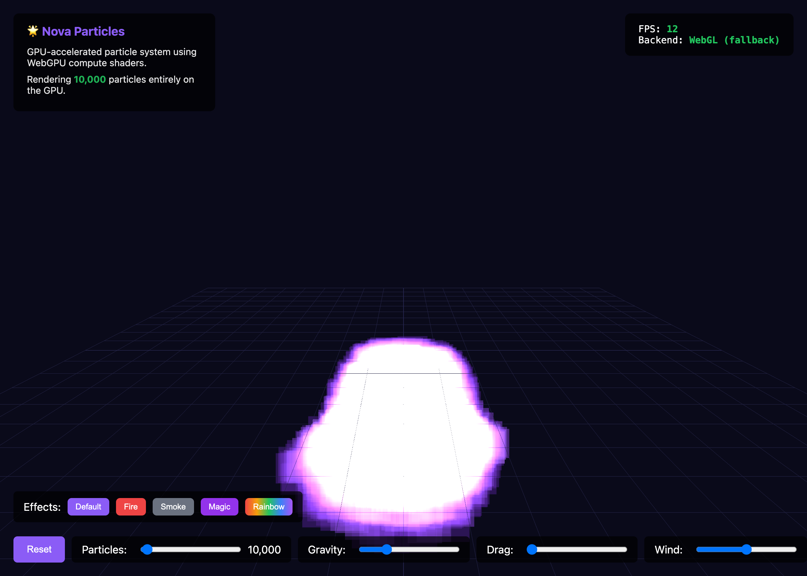

# ✨ Nova Particles



> **GPU Particle System for the Browser**
>
> Simulate large particle systems in your browser with WebGPU compute shaders and a WebGL2 fallback.

Nova Particles is a particle engine built with **Three.js** and **WebGPU**. Using compute shaders (via TSL, the Three.js Shading Language), it runs particle physics on the GPU. The demo app falls back to WebGL2 when WebGPU is unavailable.

## 🚀 Features

- **GPU compute**: particle state updates run in WebGPU compute shaders. The UI exposes up to 1M particles; frame rate depends on your GPU and browser, and no benchmark is published yet.
- **WebGPU with WebGL2 fallback**: the demo app uses the WebGPU backend when present and Three.js's WebGL2 backend otherwise.
- **Flexible emitters**: Point, Sphere, Box, Cone, and Circle shapes.
- **Forces**: Gravity, Drag, Wind, Vortex, and Noise.
- **Presets**: Fireworks, Nebula, Lightning, Portal, Fireflies, Snowfall, Energy, Toxic, Black Hole, Aurora, and Supernova.
- **Pointer forces**: turn the cursor into an attract or repel field.
- **Audio reactive**: particles pulse to microphone input.
- **Trails**: line-segment trails with alpha fade. Trail memory is capped at 2M positions (particle count x trail length); larger configurations get a shorter trail length, or trails are disabled.
- **Share and record**: copy a link that encodes the configuration, or capture the canvas to WebM.

## 🗺️ Roadmap

Not implemented yet. Tracked as GitHub issues:

- Node-based visual effect editor ([#31](https://github.com/forbiddenlink/particle-system/issues/31))
- GPU collision, which needs spatial binning first ([#28](https://github.com/forbiddenlink/particle-system/issues/28))
- GPU bitonic sort for correct alpha blending ([#27](https://github.com/forbiddenlink/particle-system/issues/27))
- Boids / flocking on the GPU ([#29](https://github.com/forbiddenlink/particle-system/issues/29))
- MLS-MPM fluid, snow, and jello simulation ([#30](https://github.com/forbiddenlink/particle-system/issues/30))
- Emit from mesh surfaces and vertices ([#25](https://github.com/forbiddenlink/particle-system/issues/25))
- Soft particles with depth-aware alpha fade ([#24](https://github.com/forbiddenlink/particle-system/issues/24))

## 📦 Tech Stack

- **Core**: [Three.js](https://threejs.org/) (WebGPU Renderer)
- **Language**: TypeScript
- **Build Tool**: Vite (for the web app)
- **Package Manager**: pnpm

## 📚 Use as a Library

The engine ships as [`@nova-particles/core`](https://www.npmjs.com/package/@nova-particles/core) (WebGPU + Three.js TSL):

```bash
pnpm add @nova-particles/core three
```

```ts
import { ParticleSystem } from "@nova-particles/core";

const system = new ParticleSystem({ maxParticles: 500_000 });
system.setGravity(0, -9.8, 0);
// drive it from your own render loop:
// await system.update(dt);
```

`three` is a peer dependency (`>=0.170.0`). The package is ESM-only and side-effect free.

## 🛠️ Getting Started

### Prerequisites

- **Node.js**: v18+
- **pnpm**: v10+
- **Browser**: Chrome 113+, Edge 113+, or Safari 18+ for WebGPU. Other browsers with WebGL2 use the fallback backend.

### Installation

1. **Clone the repository:**
   ```bash
   git clone https://github.com/forbiddenlink/particle-system.git
   cd particle-system
   ```

2. **Install dependencies:**
   ```bash
   pnpm install
   ```

3. **Run the development server:**
   ```bash
   pnpm dev
   ```

4. **Open in browser:**
   Navigate to `http://localhost:3000` to see the demo.

## 🎮 Usage Controls

- **Left Click + Drag**: Rotate camera
- **Right Click + Drag**: Pan camera
- **Scroll**: Zoom in/out
- **UI Controls**:
  - Adjust particle count (up to 1M)
  - Tweak physics (gravity, drag, wind, vortex)
  - Toggle trails
  - Select presets (Fireworks, Nebula, Lightning, Portal, Fireflies, Snowfall, Energy, Toxic, Black Hole, Aurora, Supernova)
- **Interactive tools**:
  - **Pointer**: turn your cursor into an attract/repel force field
  - **Audio**: react to your microphone: particles pulse to the beat
  - **Share**: copy a link that encodes the exact configuration
  - **Record**: capture the canvas to a downloadable WebM video

## 🧩 Architecture

Nova Particles uses a **Structure of Arrays (SoA)** approach in GPU storage buffers to maximize cache efficiency.

1.  **Storage Buffers**: Store position, velocity, life, color, and size data.
2.  **Compute Shaders**: Update particle state every frame based on physics and behaviors.
3.  **Vertex Fetch**: The renderer reads directly from these buffers to draw instances, avoiding CPU-GPU data transfer.

See [docs/architecture.md](docs/architecture.md) for the GPU pipeline flow and core module map (Mermaid diagrams).

## 📄 License

MIT © Nova Particles Team
